<!-- Animated pixel-art banner: hasan-stack.svg in the repo root (self-contained, no external service). -->

  

<h3 align="center">Contact</h3>

  
  &nbsp;
  

  <a href="mailto:hsnkivrakdal@gmail.com">hsnkivrakdal@gmail.com</a>

